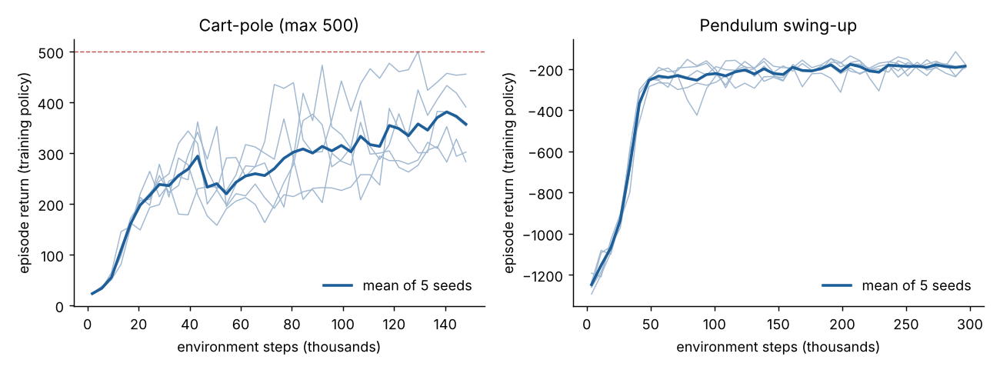
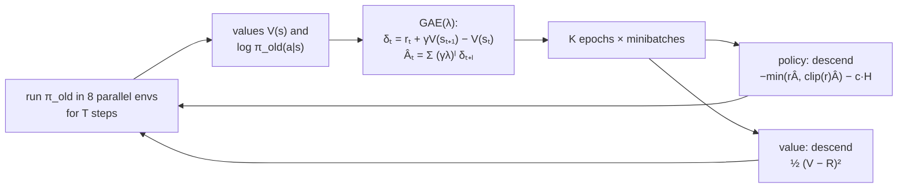
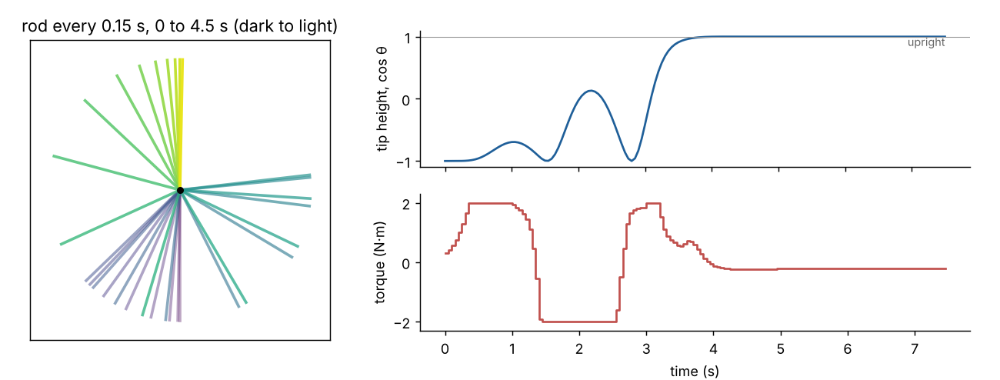
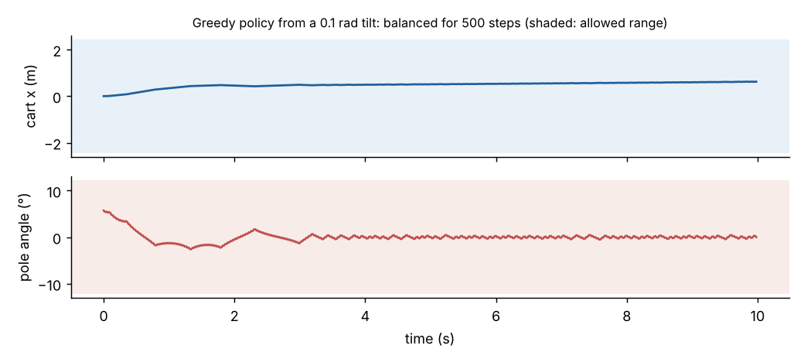

# ppo-from-scratch

Proximal Policy Optimisation in NumPy, with nothing imported to do the hard parts. The neural
networks and their backward passes, the action distributions and their gradients, generalised
advantage estimation, the clipped objective, and both control problems are all written out by
hand and checked by tests. There is no PyTorch, no autograd and no Gym.



Five seeds per task. Each thin line is one seed's training return (stochastic policy); the thick line
is their mean. A cart-pole run takes about 5 s and a pendulum run about 20 s on a 2-vCPU cloud VM.

## What's in it

| file | contents |
|---|---|
| [`ppo/nn.py`](ppo/nn.py) | tanh MLP with a hand-written backward pass, orthogonal initialisation, Adam, gradient clipping |
| [`ppo/distributions.py`](ppo/distributions.py) | categorical and diagonal-Gaussian policies: log-probability, entropy and their derivatives in closed form |
| [`ppo/agent.py`](ppo/agent.py) | rollouts in parallel environments, GAE(λ), the clipped surrogate and its gradient, minibatch updates, observation and reward normalisation |
| [`ppo/envs.py`](ppo/envs.py) | cart-pole and pendulum swing-up, derived from their equations of motion and vectorised |

## One iteration



Two details that matter more than they look:

- **Time limits are not failures.** The pendulum episode always ends at 200 steps. Treating that as
  a terminal state would teach the value function that the world ends, so the reward on a truncated
  step gets γ·V(final state) added. In other words, the learner bootstraps through the time limit.
- **Normalisation.** For the pendulum, observations are standardised with running statistics, and
  rewards are divided by the running standard deviation of the discounted return. Advantages are
  standardised per minibatch.

## The gradients

With r = π(a|s) / π_old(a|s), the per-sample policy loss is −min(rÂ, clip(r, 1−ε, 1+ε)Â). Because
∂r/∂log π = r, its derivative is

$$\frac{\partial L}{\partial \log\pi} = \begin{cases} -\hat A\, r & \text{if the unclipped term is the smaller one} \\ 0 & \text{otherwise (the objective is flat there)} \end{cases}$$

This is then chained through the distribution and back into the network:

| distribution | ∂ log π / ∂(outputs) | ∂H / ∂(outputs) |
|---|---|---|
| categorical, logits z | onehot(a) − p | −pⱼ (log pⱼ + H) |
| Gaussian, mean μ and free log σ | ∂/∂μ = (a − μ)/σ², ∂/∂log σ = ((a − μ)/σ)² − 1 | ∂/∂log σ = 1 |

The tests check every one of these with finite differences. That covers each formula on its own
and also the complete policy loss with respect to every network weight, for both tasks.

## The environments

**Cart-pole.** A uniform rod (mass m, half-length l, inertia m l²/3) is hinged on a cart. With
M = M_cart + m, Lagrange's equations give

$$\begin{bmatrix} M & m l\cos\theta \\ m l\cos\theta & \tfrac43 m l^2 \end{bmatrix} \begin{bmatrix}\ddot x\\ \ddot\theta\end{bmatrix} = \begin{bmatrix} F + m l \dot\theta^2 \sin\theta \\ m g l \sin\theta \end{bmatrix}$$

The code uses the closed-form solution. A test solves this 2×2 system directly at 200 random states
and requires agreement to 1e-12. The rules: ±10 N pushes, +1 reward per step, failure at |θ| > 12° or
|x| > 2.4 m, at most 500 steps.

**Pendulum swing-up.** A rod about a fixed pivot, with θ = 0 upright:
(m l²/3) θ̈ = m g (l/2) sin θ + u, so θ̈ = (3g/2l) sin θ + (3/ml²) u. The torque is limited to
|u| ≤ 2, which is too weak to lift the rod directly, so the policy has to pump energy by swinging.
The reward is −(θ² + 0.1θ̇² + 0.001u²).

Both use semi-implicit Euler, which is symplectic. With no control, the test shows its energy error
oscillating within about 9 % at dt = 0.05 s without growing, while explicit Euler's error passes
100 % within the same ten seconds.

## Results

Greedy (deterministic) policy after training, mean return over 20 fresh episodes:

| task | steps | seed 0 | seed 1 | seed 2 | seed 3 | seed 4 | mean |
|---|---:|---:|---:|---:|---:|---:|---:|
| cart-pole (max 500) | 150 k | 496.9 | 476.0 | 494.9 | 470.8 | 452.2 | **478.2** |
| pendulum (0 is perfect) | 300 k | −190.1 | −194.2 | −186.9 | −190.4 | −189.0 | **−190.1** |

The untrained policy scores about 17 on the cart-pole and about −1,240 on the pendulum. The
pendulum's episodes start from random angles, so even a perfect controller pays for the time it
takes to swing up, and the best achievable mean is well below zero.

The seed-0 pendulum policy, started hanging straight down, swings twice to build up energy and then
balances:



The seed-0 cart-pole policy, started from a 0.1 rad tilt (half the failure angle):



## Tests

| file | checks |
|---|---|
| `tests/test_gradients.py` | MLP weights and inputs, categorical and Gaussian log-prob and entropy derivatives, the clipped surrogate (away from its kinks), and the full policy loss for both tasks, all against finite differences |
| `tests/test_agent.py` | GAE against an O(T²) direct sum, its λ = 0 (TD error) and λ = 1 (Monte Carlo) limits, running statistics, and that both tasks actually learn |
| `tests/test_envs.py` | cart-pole closed form against the Lagrangian mass matrix, mirror symmetry, instability of upright, termination and truncation, pendulum torque balance, energy behaviour and reward |

The 20 tests take about 9 s.

## Run it

```bash
pip install -r requirements.txt pytest
pytest -q
python scripts/run_experiments.py      # five seeds per task, about 2 minutes
pip install matplotlib && python scripts/figures.py
```

## Notes and limits

- The hyperparameters are common choices for these tasks, not a tuning study. The pendulum uses
  γ = 0.9, ten epochs, 2,048 steps per iteration and a learning rate of 1e-3; the cart-pole uses
  γ = 0.99, four epochs and 2.5e-4. Both anneal the learning rate linearly.
- The value function is a separate network with no value clipping. The Gaussian policy's log σ is
  state-independent, and actions are clipped by the environment rather than squashed.
- The cart-pole learning curve shows the stochastic training policy. The greedy policy evaluated in
  the table does noticeably better.
- No comparison against a reference implementation (such as Stable-Baselines3) was run, so these
  numbers stand on their own.

## References

- J. Schulman, F. Wolski, P. Dhariwal, A. Radford, O. Klimov, *Proximal Policy Optimization Algorithms*, arXiv:1707.06347 (2017).
- J. Schulman, P. Moritz, S. Levine, M. Jordan, P. Abbeel, *High-Dimensional Continuous Control Using Generalized Advantage Estimation*, ICLR (2016).
- A. G. Barto, R. S. Sutton, C. W. Anderson, *Neuronlike adaptive elements that can solve difficult learning control problems*, IEEE Trans. SMC 13 (1983).
- M. Andrychowicz et al., *What Matters in On-Policy Reinforcement Learning? A Large-Scale Empirical Study*, ICLR (2021).
- A. M. Saxe, J. L. McClelland, S. Ganguli, *Exact solutions to the nonlinear dynamics of learning in deep linear neural networks*, ICLR (2014).
- D. P. Kingma, J. Ba, *Adam: A Method for Stochastic Optimization*, ICLR (2015).

## License

MIT
